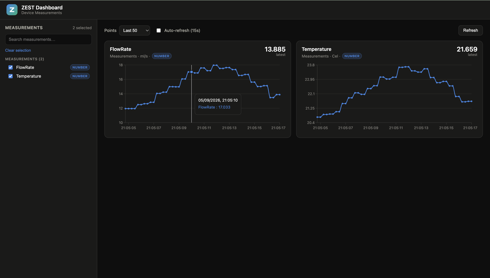

# ZEST Dashboard

A simple React dashboard for the ZEST FIWARE pipeline. It lists the live
`DeviceMeasurement` entities from **Orion-LD**, lets you pick which ones to view,
and charts each one's history from **QuantumLeap**.

- **Numeric** measurements (`numValue`) → line chart
- **Boolean** measurements (`boolValue`, e.g. alarms) → step chart (0/1)
- **Text** measurements (`textValue`) → latest-values table



## Prerequisites

The dashboard talks to the ZEST cluster (`../zest-cloud-k8s`). Because neither
Orion nor QuantumLeap emit CORS headers, the Vite dev server proxies to them and
injects the required FIWARE headers. You just need the services reachable on
`localhost`:

```bash
# in ../zest-cloud-k8s
./manage.sh start
minikube tunnel        # maps the LoadBalancer services to localhost:1026 / :8668
```

Make sure there is data to show — either the BioPC OPC-UA agent
(`../biopc-client`) is running, or seed the mock feed:

```bash
# in ../zest-cloud-k8s  (mock data lands in the DEFAULT tenant — see config note below)
python3 scripts/send_mock_measurements.py
```

You can sanity-check the raw APIs the dashboard mirrors:

```bash
# in ../biopc-client
./check-orion.sh                                   # live entity list (Orion)
./query-quantumleap.sh BioPC.ProcessVariables.T3_PV  # history (QuantumLeap)
```

## Run

```bash
npm install
npm run dev
```

Open the printed URL (default http://localhost:5173).

## Configuration

Config lives in `.env` (copied from `.env.example`) and is consumed by
`vite.config.js` — restart `npm run dev` after changing it.

| Variable | Default | Purpose |
|---|---|---|
| `VITE_ORION_URL` | `http://localhost:1026` | Orion-LD base URL |
| `VITE_ORION_TENANT` | `opcua_biopc` | Orion tenant. **Set empty** to target the zest-cloud mock data (default tenant). |
| `VITE_QL_URL` | `http://localhost:8668` | QuantumLeap base URL |
| `VITE_NGSILD_CONTEXT` | smart-data-models Device context | `@context` for the Orion `Link` header |

**To view the mock data** (`send_mock_measurements.py`), set:

```
VITE_ORION_TENANT=
```

QuantumLeap is queried with `Fiware-ServicePath: /` and **no** `Fiware-Service`
header, so biopc/mock history in QuantumLeap's default tenant is read the same way
in both cases.

## How it works

```
Browser ──/api/orion/*──▶  Vite proxy ──▶ Orion-LD :1026   (adds Link + NGSILD-Tenant)
        ──/api/quantumleap/*─▶ Vite proxy ──▶ QuantumLeap :8668 (adds Fiware-ServicePath)
```

- `src/api/fiware.js` — `listDeviceMeasurements()` (Orion) and
  `getAttrHistory(id, attr, lastN)` (QuantumLeap).
- `src/lib/measurements.js` — parses each entity's id into a label/category and
  detects its attribute type (`numValue`/`boolValue`/`textValue`).
- `src/components/` — `Header`, `MeasurementPicker` (search + grouped multi-select),
  `Dashboard` (state + toolbar), `MeasurementChart` (one card, Recharts).

## Production image (nginx)

For deployment the app is built to static files and served by **nginx**, which
also reverse-proxies the two FIWARE backends — doing at runtime what the Vite
dev-server proxy does in development (prefix stripping + FIWARE header
injection). The browser keeps calling the same `/api/*` paths, so `src/` is
unchanged.

```
Browser ──/ (static SPA) ─────────────▶ nginx  (serves dist/, SPA fallback)
        ──/api/orion/* ───────────────▶ nginx ──▶ Orion-LD      (adds Link + NGSILD-Tenant)
        ──/api/quantumleap/* ─────────▶ nginx ──▶ QuantumLeap   (adds Fiware-ServicePath)
```

Backends and tenant are **runtime** env vars (nothing is baked into the bundle),
so one image works across environments:

| Env var | Default | Purpose |
|---|---|---|
| `ORION_URL` | `http://orion:1026` | Orion-LD upstream (k8s service DNS name in-cluster) |
| `QUANTUMLEAP_URL` | `http://quantumleap:8668` | QuantumLeap upstream |
| `ORION_TENANT` | `opcua_biopc` | Sent as `NGSILD-Tenant`. **Set empty** to target the default-tenant mock data. |
| `NGSILD_CONTEXT` | smart-data-models Device context | `@context` for the Orion `Link` header |

Build and run locally:

```bash
docker build -t zest-dashboard .
docker run --rm -p 8080:80 \
  -e ORION_URL=http://host.docker.internal:1026 \
  -e QUANTUMLEAP_URL=http://host.docker.internal:8668 \
  -e ORION_TENANT= \
  zest-dashboard
# open http://localhost:8080
```

## CI/CD (GitHub Actions)

`.github/workflows/docker-publish.yml` builds the image and pushes it to the
GitHub Container Registry (`ghcr.io/zest-eu/data-dashboard`) **when you create a
version tag**. From the GitHub web UI: **Releases → Draft a new release →**
choose a new tag like `v1.2.3` **→ Publish** (or `git push origin v1.2.3`).

A tag `v1.2.3` publishes `:1.2.3`, `:1.2`, `:latest`, and a short-SHA tag. The
workflow uses the built-in `GITHUB_TOKEN` (no secrets to configure); the first
run creates the package — set its visibility under the repo's **Packages** if it
needs to be public.

## Notes / future work

- `public/zest-logo.svg` is a **placeholder** — swap it for the real ZEST logo.
- Not yet built: authentication (Keycloak/OAuth2), a production reverse-proxy/BFF,
  date-range (`fromDate`/`toDate`) selection, friendly labels from
  `biopc_tag_list.csv`, overlaying multiple series on shared axes.
